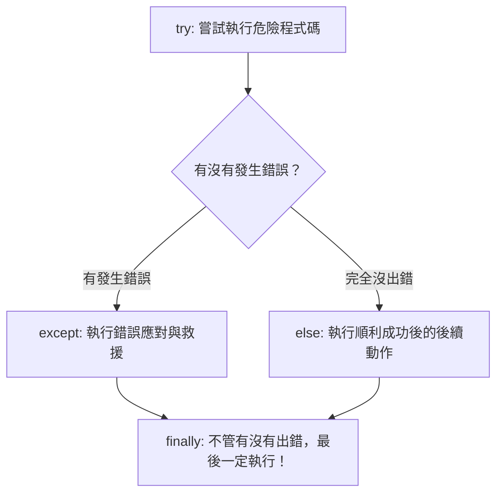

# Python 例外處理（Exception Handling）新手全攻略

歡迎來到 Python 的安全防護特訓！在寫程式的過程中，你一定遇過滿螢幕紅字、程式突然「當機」或「閃退」的挫折時刻。

這份教學將用最生活化的比喻，帶你學會如何為程式架設「**安全防護網**」，就算遇到突發狀況，程式也能優雅應對、穩定運行！

---

## 什麼是例外（Exception）？——生活中的「安全防護網」比喻

想像一下特技演員在空中走鋼索：
- **沒加防護網**：只要一個踩空失足，演員就會直接重摔落地（程式當機崩潰、紅字報錯中止）。
- **加了防護網（例外處理）**：就算踩空，演員也會穩穩掉在網子裡，拍拍灰塵換條路走，表演依然可以順利繼續（捕獲錯誤，給予友善提示，程式繼續往下執行）。

在 Python 中，**「例外（Exception）」就是程式執行時踩空掉下來的意外狀況**。而 `try...except` 就是我們替程式架設的防護網！

---

## 一、語法錯誤 vs 執行時期例外

在學防護網之前，要先分清兩種不同類型的錯誤：

| 類型 | 比喻 | 發生時機 | 能否用 `try...except` 捕捉？ |
| :--- | :--- | :--- | :--- |
| **語法錯誤 (SyntaxError)** | 英文單字拼錯、文法不通 | 程式還沒開始跑，Python 編譯時就直接拒絕執行。 | ❌ **不能**（必須先把語法改對） |
| **執行時期例外 (Exception)** | 照食譜煮菜，突然發現醬油沒了或糖加成鹽 | 語法完全合法，但**執行到某一行**時發生突發狀況（如除以 0、找不到檔案）。 | ⭕ **可以！** 這就是例外處理的守備範圍！ |

---

## 二、最基礎的防護網：`try...except`

### 1. 語法結構

```python
try:
    # 這裡放「可能出事」的危險動作（走鋼索）
    危險操作
except:
    # 萬一真的出事了，在這裡執行救援計畫（防護網接住）
    救急備案
```

### 2. 經典踩坑案例：除以零（ZeroDivisionError）

```python
# ❌ 沒有例外處理：直接當機報錯
# 10 / 0  -> 拋出 ZeroDivisionError: division by zero

# ⭕ 加上 try...except 防護網：
try:
    number = int(input("請輸入除數: "))
    result = 10 / number
    print(f"計算結果是: {result}")
except:
    print("⚠️ 哎呀！計算過程出錯囉，請確認輸入不能為 0！")

print("程式順利執行完畢，沒有當機崩潰！")
```

---

## 三、精準救援：指名道姓捕捉特定例外

> [!WARNING]
> 初學者最常寫空空的 `except:`（不指定任何錯誤型別）。
> 這就像「不管生什麼病通通只吃止痛藥」，雖然程式不當機，但你永遠不知道到底哪裡生病了！
> **最佳實踐：指名道姓捕捉特定的錯誤！**

### 常見的 Python 內建例外清單

| 例外名稱 | 常見發生原因 | 生活化比喻 |
| :--- | :--- | :--- |
| `ZeroDivisionError` | 任何數除以 `0` | 把一塊蛋糕分給 0 個人（邏輯上不可能） |
| `ValueError` | 傳入無效的值（例如把字串 `"abc"` 轉整數） | 投幣機要求投硬幣，你卻塞了一張紙片 |
| `FileNotFoundError` | 想要讀取的檔案在電腦中不存在 | 去書架找一本根本沒買過的書 |
| `IndexError` | 串列索引超出範圍（例如長度 3 卻想拿第 10 個） | 只有 3 間號碼房，卻叫 10 號房客人出來 |
| `KeyError` | 字典中找不到指定的鍵（Key） | 字典查不到這個單字 |
| `TypeError` | 型別不相容（例如把文字與數字相加 `"5" + 3`） | 拿汽油去加柴油車 |

### 多重 `except` 示範：對症下藥

```python
try:
    num = int(input("請輸入一個整數："))
    ans = 100 / num
    print(f"100 除以 {num} 是 {ans}")

except ValueError:
    print("❌ 請輸入數字，不要輸入國字或英文！")

except ZeroDivisionError:
    print("❌ 除數不能是 0，數學上沒有這種除法！")

except Exception as e:
    # 捕捉其他預料之外的例外，並印出系統訊息
    print(f"❌ 發生未預期的錯誤: {e}")
```

---

## 四、取得系統詳細錯誤訊息：`as e`

有時候你想知道 Python 系統原本報錯的具體原因，可以使用 `as e`（`e` 代表 Exception 物件）：

```python
try:
    scores = [90, 80, 70]
    print(scores[5])  # 索引超出範圍
except IndexError as e:
    print(f"捕獲到索引錯誤！系統原因：{e}")  # 輸出：list index out of range
```

---

## 五、四部曲全家福：`try...except...else...finally`

這是 Python 例外處理最完整的架構：



### 生活化比喻：出門買便當
- `try`：出門去買巷口的排骨便當（嘗試執行）。
- `except`：排骨便當賣完了，改去買泡麵應急（出錯時救援）。
- `else`：順利買到排骨便當！開心地加顆滷蛋享用（**沒出錯才會執行**）。
- `finally`：**不管今天吃便當還是吃泡麵，最後一定都要洗手洗碗、關瓦斯**（資源清理與善後，一定會執行）。

### 程式碼示範

```python
def divide(a, b):
    try:
        result = a / b
    except ZeroDivisionError:
        print("【except】不能除以零！")
    else:
        print(f"【else】計算大成功！結果是: {result}")
    finally:
        print("【finally】這行無論如何一定會被執行（清理現場）！")
        print("-" * 30)

# 測試 1：正常情況
divide(10, 2)

# 測試 2：出錯情況
divide(10, 0)
```

---

## 六、主動拉響警報：`raise` 拋出例外

除了被動防禦，有時候邏輯不合理時，你可以**主動拉響警報**，這叫做 `raise`。

### 比喻：門禁警衛
警衛看到年齡小於 0 歲的人要註冊會員，主動按響警鈴！

```python
def register_member(name, age):
    if age < 0:
        # 主動拋出例外，告訴呼叫者這個數值不合法！
        raise ValueError("年齡不能為負數！")
    print(f"會員 {name} 註冊成功，年齡：{age} 歲。")

try:
    register_member("小明", -5)
except ValueError as e:
    print(f"註冊失敗，原因：{e}")
```

---

## 七、實戰小技巧：安全的「防呆」使用者輸入器

結合 `while True` 與 `try...except`，做出「使用者沒輸對就不放行」的防呆機制：

```python
def get_valid_integer(prompt):
    while True:
        try:
            val = int(input(prompt))
            return val  # 輸入正確，回傳數字並跳出迴圈
        except ValueError:
            print("⚠️ 格式錯誤！請重新輸入合法的整數。")

# 測試呼叫：
# age = get_valid_integer("請輸入您的年齡: ")
# print(f"您輸入的年齡是: {age}")
```

---

## 八、執行範例程式檔

本資料夾已附帶可獨立執行的示範腳本 [`exception_example.py`](file:///D:/python/test/2026_11_18/exception_example.py)。
請打開終端機，在專案目錄下執行以下指令體驗完整範例：

```powershell
uv run python 2026_11_18/exception_example.py
```
