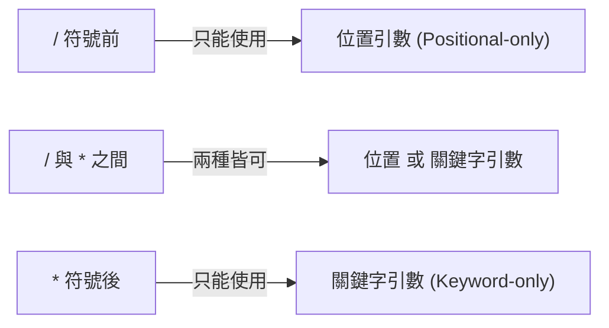

# Python 函式參數與引數傳遞完全說明書

本說明書專門解析 [`function.ipynb`](file:///D:/python/test/2026_11_18/function.ipynb) 筆記本中的所有程式碼區塊。
從最基礎的「參數 vs 引數」概念，到進階的特殊符號（`/`、`*`）以及萬能打包（`*args`、`**kwargs`），以生活化比喻帶你徹底搞懂 Python 函式的輸入機制！

---

## 快速概念總覽（生活化比喻）

如果把函式比喻成一間**客製化飲料店**：
- **參數（Parameter）**：點單菜單上的空白欄位（如：飲料品項、冰塊、甜度）。
- **引數（Argument）**：客人點單時實際填入的內容（如："珍珠奶茶"、"少冰"、"半糖"）。
- **位置引數**：按照菜單欄位順序口頭點餐（第 1 個講品項、第 2 個講冰塊）。
- **關鍵字引數**：指名道姓點餐（例如：「冰塊要微冰、飲料要紅茶」），順序反了也沒關係。
- **預設值（Default）**：客人不特別指定時，店家預設配置（如：預設正常冰、半糖）。
- **`*args`**：大賣場購物車，客人愛裝幾顆蘋果就裝幾顆，全部打包成一籃（Tuple）。
- **`**kwargs`**：貼標籤的百寶箱，客人愛附加什麼客製需求（加料="椰果"、溫度="溫"），全部打包成字典（Dictionary）。

---

## 第一單元：參數 vs 引數（基礎定義）

對應筆記本：`Cell 1`

### 程式碼
```python
# 參數(parameter)是函式的輸入值，引數(argument) --> 是呼叫函式時傳遞給參數的值。
def greet(name):
    print(f"Hello, {name}!")

greet("Alice")
```

### 深度解說
- **參數（Parameter）**：在 `def greet(name):` 括號裡的 `name`。它是一個「佔位符」，像表單上的空白欄位，等待被填入。
- **引數（Argument）**：在呼叫 `greet("Alice")` 時傳入的 `"Alice"`。它是真正運算時使用的實體資料。

> [!TIP]
> **口訣記憶法**：
> - **參**數（Parameter）= 定義函式時的**參**考欄位。
> - **引**數（Argument）= 呼叫函式時**引**進去的真實資料。

---

## 第二單元：位置引數 vs 關鍵字引數

對應筆記本：`Cell 2`

### 程式碼
```python
# 引數位置 (positional argument) --> 依照參數的順序傳遞給函式。
def pet(animal, name):
    print(f"我養了一隻{animal}，它叫{name}。")

# 1. 位置引數：嚴格按照順序填入
pet("狗", "小白")  # 輸出：我養了一隻狗，它叫小白。

# 2. 關鍵字引數：透過指定參數名稱傳遞
pet(animal="貓", name="小黑")  # 輸出：我養了一隻貓，它叫小黑。
pet(name="小黑", animal="貓")  # 改變順序也完全正常！
```

### 深度解說
1. **位置引數（Positional Argument）**：
   - 依照定義順序配對。第 1 個丟進去的一定給第 1 個參數，第 2 個給第 2 個參數。
   - **危險性**：如果順序寫反變成 `pet("小白", "狗")`，就會印出「我養了一隻小白，它叫狗」，邏輯就會大錯特錯。
2. **關鍵字引數（Keyword Argument）**：
   - 明確寫出 `參數名稱=值`。
   - **優點**：可讀性高，且**順序不受限制**，Python 知道誰該給誰。

---

## 第三單元：混用時的重要黃金法則

對應筆記本：`Cell 3`

### 程式碼
```python
## 重要規則：混用時 "位置引數" 必須放在 "關鍵字引數" 前面，否則會出現語法錯誤。
pet("狗", name="小白")  # ⭕ 正確：位置引數在前面，關鍵字在後面
```

### 錯誤示範（避坑提醒）
```python
# ❌ 錯誤示範：關鍵字引數放在位置引數前面
pet(animal="狗", "小白")
```
> **語法錯誤（SyntaxError）**：
> `SyntaxError: positional argument follows keyword argument`
>
> [!CAUTION]
> **黃金鐵律**：在 Python 裡，**位置引數永遠必須排在關鍵字引數的前面**！不能先指定了關鍵字，後面又突然塞一個沒有標籤的位置引數。

---

## 第四單元：預設值參數（Default Arguments）

對應筆記本：`Cell 4`

### 程式碼
```python
def order_drink(drink, ice="正常冰", sugar="半糖"):
    print(f"點餐：{drink} {ice} / {sugar}")

order_drink("珍珠奶茶")            # 輸出：點餐：珍珠奶茶 正常冰 / 半糖
order_drink("綠茶", ice="少冰")     # 輸出：點餐：綠茶 少冰 / 半糖
order_drink("紅茶", sugar="無糖")   # 輸出：點餐：紅茶 正常冰 / 無糖
```

### 深度解說
- **預設值的好處**：呼叫函式時，使用者只傳遞必要的引數即可，非必要的會自動套用預設設定。
- **彈性搭配**：可透過關鍵字引數針對單一參數進行微調（例如只想調糖度，不調冰塊）。
- **定義順序注意**：在定義函式時，**有預設值的參數必須放在沒有預設值的參數後面**（例如 `drink` 必須在 `ice` 前面）。

---

## 第五單元：進階語法 —— 門禁特殊符號 `/` 與 `*`

對應筆記本：`Cell 5 & 6`

Python 3.8 新增了強大的參數限制語法：斜線 `/` 與星號 `*`。

### 語法格式
```text
def 函式名稱(僅能位置引數 , / , 位置或關鍵字皆可 , * , 僅能關鍵字引數):
```



### 筆記本範例剖析
```python
def register(id, /, name, *, email):
    print(f"註冊成功！ID: {id}, 姓名: {name}, 電子郵件: {email}")

# ⭕ 正確呼叫
register(123, "Alice", email="alice@example.com")
register(123, name="Alice", email="alice@example.com")
```

### 各欄位限制詳解：
1. **`id`（在 `/` 前面）**：
   - 只能用**位置**傳遞！
   - ❌ 寫成 `register(id=123, ...)` 會引發 `TypeError: register() got some positional-only arguments passed as keyword arguments: 'id'`。
2. **`name`（在 `/` 與 `*` 之間）**：
   - 中規中矩，傳 `"Alice"` 或 `name="Alice"` 都可以。
3. **`email`（在 `*` 後面）**：
   - 只能用**關鍵字**傳遞！
   - ❌ 寫成 `register(123, "Alice", "alice@example.com")` 會引發 `TypeError`，必須明確加上 `email=`。

> [!NOTE]
> **為什麼需要這種設計？**
> 1. 保護敏感 API：避免使用者依賴內部的參數命名，日後改參數名字也不會壞掉。
> 2. 避免語意混淆：強制重要的選項必須指名（如 `email=`），防止傳錯位置。

---

## 第六單元：任意數量的位置引數（`*args`）

對應筆記本：`Cell 7`

### 程式碼
```python
def sum_squares(*numbers):
    total = sum(x ** 2 for x in numbers)
    return total

result = sum_squares(1, 2, 3, 4)
print(f"平方和: {result}")  # 輸出：平方和: 30
```

### 深度解說
- **單星號 `*` 的魔法**：它會把所有傳進來、多餘的位置引數通通**打包成一個元組（Tuple）**。
- 在函式內部，`numbers` 會變成 `(1, 2, 3, 4)`。
- 你可以傳入 1 個、4 個甚至 100 個數字，函式都能通用處理：
  ```python
  sum_squares(5)        # numbers = (5,) -> 25
  sum_squares(1, 2, 3)  # numbers = (1, 2, 3) -> 14
  ```

---

## 第七單元：任意數量的關鍵字引數（`**kwargs`）

對應筆記本：`Cell 8`

### 程式碼
```python
def build_profile(name, age, **info):
    profile = {
        "name": name,
        "age": age
    }
    profile.update(info)
    return profile

user_profile = build_profile("Alice", 30, location="New York", profession="Engineer")
print(user_profile)
# 輸出：{'name': 'Alice', 'age': 30, 'location': 'New York', 'profession': 'Engineer'}
```

### 深度解說
- **雙星號 `**` 的魔法**：它會把所有額外傳入的「關鍵字引數」打包成一個**字典（Dictionary）**。
- 在這個範例中：
  - `name` 接收 `"Alice"`
  - `age` 接收 `30`
  - `**info` 把剩下的 `location="New York"` 與 `profession="Engineer"` 打包為 `{"location": "New York", "profession": "Engineer"}`。
- **使用時機**：非常適合用在「個人基本資料」、「伺服器配置設定」等充滿彈性、隨時會擴充欄位的場景。

---

## 參數與引數傳遞綜合速查表

| 語法型式 | 範例定義 | 呼叫範例 | 特點與說明 |
| :--- | :--- | :--- | :--- |
| **位置引數** | `def f(a, b):` | `f(1, 2)` | 依順序傳遞，最常見最基礎 |
| **關鍵字引數** | `def f(a, b):` | `f(b=2, a=1)` | 指名傳遞，順序可顛倒 |
| **預設值引數** | `def f(a, b=10):` | `f(5)` | 未傳入時自動使用預設值 |
| **僅限位置 (`/`)** | `def f(a, /):` | `f(1)` | 不能寫 `f(a=1)` |
| **僅限關鍵字 (`*`)**| `def f(*, key):` | `f(key=1)` | 必須寫 `f(key=1)`，不能寫 `f(1)` |
| **任意位置引數** | `def f(*args):` | `f(1, 2, 3)` | 打包成 **Tuple（元組）** |
| **任意關鍵字引數** | `def f(**kwargs):`| `f(x=1, y=2)`| 打包成 **Dict（字典）** |

---

## 執行範例程式檔

本目錄已配套提供可獨立運行的 Python 腳本 [`function_args_example.py`](file:///D:/python/test/2026_11_18/function_args_example.py)。
你可以在專案目錄下執行以下指令，直接於終端機觀看上述所有章節的執行結果：

```powershell
uv run python 2026_11_18/function_args_example.py
```
