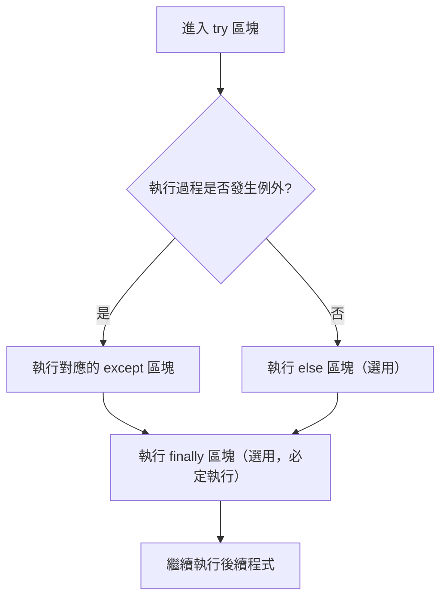

# Python `try ~ except` 例外處理：從入門到進階完全指南

歡迎來到今天的 Python 課程！寫程式時難免會遇到突發狀況（例如使用者輸入錯字、除數為 `0`、或是找不到檔案）。如果沒有做好防護，程式就會直接「當機閃退」，留下一堆嚇人的紅色錯誤訊息。

這份講義會帶你**由淺至深**掌握 `try ~ except` 例外處理機制，讓你的程式即使遇到意外，也能優雅應對、穩定運作！

> [!TIP]
> 本講義附有可獨立執行的範例程式 [try_except_example.py](file:///D:/python/test/2026_11_25/try_except_example.py)，建議上課時一邊閱讀講義、一邊執行 `uv run python 2026_11_25/try_except_example.py` 觀察終端機輸出！

---

## 第一階（初探）：為什麼程式會「當機」？

### 1. 生活化比喻：走鋼索的安全防護網
想像一位特技演員在高空走鋼索：
- **沒有防護網**：只要踩空一步，表演立刻中止，演員直接重摔落地（程式直接當機崩潰）。
- **架設防護網（`try ~ except`）**：就算不小心踩空，演員會安全掉進網子裡，拍拍灰塵、告訴觀眾「剛才有點小失誤，我們重來一次」，表演就能繼續進行！

### 2. 先分清楚：語法錯誤 vs 執行時期例外
不是所有的錯誤都能用 `try ~ except` 接住喔！

| 類型 | 生活化比喻 | 發生時機 | 能否用 `try ~ except` 捕捉？ |
| :--- | :--- | :--- | :---: |
| **語法錯誤 (`SyntaxError`)** | 寫作文時漏了標點符號、拼錯單字 | 程式還沒開始跑，Python 翻譯官直接拒讀 | ❌ **不能**（必須先改對語法） |
| **執行時期例外 (`Exception`)** | 照食譜煮菜，突然發現「鹽巴用完了」 | 語法完全正確，但**跑到某一行**時發生意外 | ✅ **可以！** 這就是防護網的守備範圍 |

### 3. 最基礎的語法結構
```python
try:
    # 【走鋼索區】放入「有可能出事」的程式碼
    num = int("abc")  # 這裡會引發 ValueError
except:
    # 【安全防護網】萬一出事了，執行這裡的備案
    print("⚠️ 發生錯誤！請確認輸入的是數字。")
```

---

## 第二階（入門）：精準接球，不再亂吃止痛藥

### 1. 為什麼不要寫空的 `except:`？
> [!WARNING]
> **新手常見地雷**：寫成空空的 `except:`（不指定任何錯誤名稱），就像「不管是胃痛、骨折還是感冒，通通只吃止痛藥」。雖然表面上程式沒當機，但你完全不知道哪裡出問題，甚至會把你按 `Ctrl+C` 想強制中斷程式的訊號也吞掉！

### 2. 指名道姓捕捉特定例外 + `as e` 取得詳情
我們應該針對不同的錯誤「對症下藥」，並用 `as e` 把錯誤物件存下來查看原因：

| 常見內建例外 | 常見發生原因 | 生活化比喻 |
| :--- | :--- | :--- |
| `ZeroDivisionError` | 任何數除以 `0` | 把 10 顆蘋果平分給 0 個人 |
| `ValueError` | 型別對了，但「數值內容」不合理（如 `int("abc")`） | 投幣機要求投硬幣，你卻塞進一張紙條 |
| `TypeError` | 資料型別完全不相容（如 `"5" + 3`） | 拿汽油去加電動車 |
| `IndexError` | 串列（List）索引超出範圍 | 只有 3 間客房，卻要找 10 號房的房客 |
| `KeyError` | 字典（Dict）中找不到指定的鍵（Key） | 在通訊錄裡查一個不存在的名字 |
| `FileNotFoundError` | 找不到要開啟的檔案 | 去圖書館借一本根本沒出版的書 |

#### 多重 `except` 與合併捕捉寫法
```python
def parse_and_divide(text_num, divisor):
    try:
        value = int(text_num)
        result = value / divisor
        print(f"計算成功：{value} / {divisor} = {result}")
    except ValueError as e:
        print(f"❌ 數值轉換失敗（{e}）：請輸入整數格式！")
    except ZeroDivisionError:
        print("❌ 數學錯誤：除數不能為 0！")
    except (TypeError, KeyError) as e:
        # 也可以用括號把多種錯誤合併在一起處理
        print(f"❌ 型別或鍵值錯誤：{e}")
```

> [!NOTE]
> 如果需要一個「最後防線」捕捉沒預料到的錯誤，請寫 `except Exception as e:`，而不要寫裸 `except:`，這樣才不會攔截到系統中斷訊號（如 `KeyboardInterrupt`）。

---

## 第三階（進階）：完整生命週期 `try ~ except ~ else ~ finally`

### 1. 生活化比喻：餐廳點餐與打烊流程
想像你去一家餐廳吃飯，這四個區塊各司其職：
1. **`try`（嘗試點餐與用餐）**：執行可能發生狀況的動作（例如「刷卡結帳」）。
2. **`except`（刷卡失敗的備案）**：萬一餘額不足或機器斷線，改用現金或換一張卡。
3. **`else`（完全沒出錯的獎勵）**：**只有在 `try` 完全順利、沒有發生任何例外時**才會執行（例如「結帳成功，獲贈餐後甜點一份」）。
4. **`finally`（打烊前必做的收尾）**：**不管剛才點餐成功還是刷卡失敗，最後一定都會執行**（例如「收走餐盤、關閉收銀機電源」）。常用於關閉檔案、釋放網路連線或資料庫資源。

### 2. 執行流程圖



### 3. 程式碼示範
```python
def checkout(balance, cost):
    print(f"--- 準備結帳：餘額 {balance} 元，消費 {cost} 元 ---")
    try:
        if cost < 0:
            raise ValueError("消費金額不可為負數")
        if balance < cost:
            raise RuntimeError("餘額不足")
        remaining = balance - cost
    except (ValueError, RuntimeError) as e:
        print(f"⚠️ 結帳失敗：{e}")
    else:
        # 只有 try 完全沒出錯時才會跑到這裡
        print(f"✅ 結帳成功！剩餘餘額：{remaining} 元，贈送甜點一份！")
    finally:
        # 無論成功或失敗，一定會執行收尾
        print("🧾 [finally] 列印交易紀錄並關閉收銀台。")
```

---

## 第四階（實戰）：主動出擊 `raise` 與例外傳遞

### 1. 為什麼要自己 `raise`（拋出例外）？
有時候程式語法上沒有錯，但**違反了業務邏輯**！  
以我們今天的練習檔 [calc.py](file:///D:/python/test/2026_11_25/calc.py) 為例：

```python
def divide(a, b):
    if b == 0:
        # 主動攔截不合理的輸入，並給出清楚的中文錯誤訊息
        raise ValueError("除數不可為零")
    return a / b
```

這裡 `divide()` 選擇**不自己印出錯誤訊息**，而是用 `raise ValueError("除數不可為零")` 把問題「往外回報」給呼叫它的人。

### 2. 例外傳遞（Call Stack 向上冒泡）
當函式內部發生例外且沒有被攔截時，例外會像水裡的氣泡一樣**一層一層往上浮（Call Stack）**，直到遇到有能力處理它的 `try ~ except` 為止；如果一路浮到最外層都沒人接，程式就會當機。

```python
from calc import divide

def calculate_average(total, count):
    # 這裡不處理錯誤，讓 divide() 拋出的 ValueError 往外傳遞
    return divide(total, count)

# 由最外層（UI 或主程式）統一決定如何呈現錯誤給使用者
try:
    avg = calculate_average(100, 0)
    print(f"平均值為：{avg}")
except ValueError as e:
    print(f"主程式接獲回報：{e}")
```

> [!TIP]
> **設計心法**：底層工具函式（如 `divide`）負責檢查條件並 `raise` 清楚的例外；外層互動介面（如命令列選單或網頁 API）負責 `try ~ except` 接住例外，決定要印提示、重試還是寫入紀錄。

---

## 第五階（高階）：自訂例外類別與例外鏈

### 1. 建立自己的專屬例外（Custom Exception）
當專案變大時，只用 `ValueError` 可能不夠明確。我們可以繼承 Python 內建的 `Exception` 類別，打造一看就懂的業務例外：

```python
class InsufficientBalanceError(Exception):
    """自訂例外：當帳戶餘額不足時拋出"""
    pass


def withdraw(balance, amount):
    if amount > balance:
        raise InsufficientBalanceError(
            f"提款失敗：想領 {amount} 元，但餘額只有 {balance} 元"
        )
    return balance - amount
```

### 2. 重新拋出（bare `raise`）與例外鏈（`raise ... from e`）
有時候我們在 `except` 裡想先「做個紀錄（Log）」，再把原本的錯誤繼續往外拋，或包裝成更高層次的錯誤同時保留原始線索：

```python
# 用法 A：紀錄後原封不動重新拋出
try:
    result = 10 / 0
except ZeroDivisionError:
    print("📝 [Log] 偵測到除以零，先寫入系統日誌...")
    raise  # 不加任何參數的 raise，會把原本的 ZeroDivisionError 繼續往外丟


# 用法 B：包裝成自訂例外，並用 from e 保留原始病因（Exception Chaining）
class ConfigLoadError(Exception):
    """設定檔讀取失敗"""
    pass

def load_port(raw_text):
    try:
        return int(raw_text)
    except ValueError as e:
        raise ConfigLoadError(f"無法解析連接埠設定：'{raw_text}'") from e
```

---

## 第六階（最佳實踐）：寫出專業程式碼的黃金守則

1. **縮小 `try` 的包圍範圍**：只把「真的可能出錯的那一兩行」放進 `try`，不要把整個 50 行的函式都塞進去，否則會很難抓到真正的 Bug。
2. **EAFP 風格（Pythonic 精神）**：
   - **LBYL（Look Before You Leap，三思而後行）**：先用一堆 `if` 檢查完再執行。
   - **EAFP（Easier to Ask for Forgiveness than Permission，請求原諒比請求許可更容易）**：Python 非常鼓勵直接 `try` 去做，真的失敗再由 `except` 處理，程式碼往往更簡潔且能避免競態條件。
3. **永遠不要靜默吞掉錯誤**：在 `except` 裡至少要印出提示、寫入 `logging` 日誌，或是進行明確的補救，切忌寫 `except Exception: pass` 假裝沒事發生。

---

## ✏️ 隨堂小練習

試著動手寫寫看，檢驗今天學到的觀念吧！

### 練習 1：防呆的數字輸入迴圈
請寫一個 `while True` 迴圈，請使用者輸入一個整數。如果使用者輸入 `"abc"` 等非數字文字，程式不會當機，而是提示「輸入格式錯誤，請重新輸入整數」，直到輸入正確為止並印出該數字。

### 練習 2：結合 `calc.py` 的安全除法計算機
匯入 [calc.py](file:///D:/python/test/2026_11_25/calc.py) 的 `divide(a, b)`，讓使用者分別輸入被除數與除數：
- 使用 `try ~ except ~ else ~ finally` 結構。
- 同時防範「輸入不是數字（`ValueError`）」以及 `divide()` 主動拋出的「`除數不可為零`」。
- 在 `else` 印出計算結果，在 `finally` 印出 `"本次計算流程結束"`。
